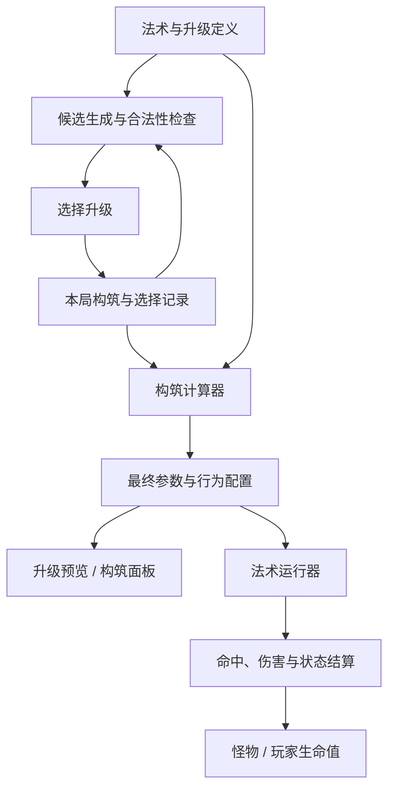

# 升级兼容架构

状态：基础架构已实现，三种流派法术与冰霜减速已实现，危险升级及其他状态结算待扩展。玩法与数值约定见 [攻击升级与组合设计](attack-upgrade-design.md)。当前 `FireballSpell` 已读取计算后的参数，支持多重、穿透和首次命中爆炸，旧弹丸保留发射快照。

## 1. 核心结构

升级保存玩家的选择；构筑计算器把选择转换为最终攻击参数和行为；法术运行器执行这些结果。已有能力通过组合保留，新的升级只增加参数或行为。



首版用五个职责明确的模块：升级定义、构筑状态、构筑计算器、法术运行器、战斗结算。模块之间通过明确的参数和返回值调用，伤害事件集中在战斗结算内部处理。

## 2. 升级定义：描述增量

每张升级卡有稳定 ID、适用法术、最大层数、前置条件、候选权重及效果。名称和卡片文案用于展示，稳定 ID 用于状态、记录和存档。

效果分两类：

| 类别 | 例子 | 执行位置 |
| --- | --- | --- |
| 数值修正 | 伤害 +30%、弹丸数 +2、额外穿透 +1、冷却减免 10% | 选择升级后，由构筑计算器计算 |
| 行为能力 | 首次命中爆炸、命中留下火区、每第四次闪电超载 | 法术运行器和战斗结算在对应事件发生时执行 |

建议使用 TypeScript 的明确联合类型描述效果，例如 `DamageBasePercent`、`ProjectileCountAdd`、`PierceAdd`、`EnableExplosion`、`EnableFireZone`。参数字段受类型约束，不由升级文案或任意字符串决定运行逻辑。

同一种行为只有一个运行配置。例如普通爆炸和危险爆燃都需要爆炸时，计算器合成一个 `ExplosionSpec`，危险能力扩展其半径并附加火区，不注册两个相同的爆炸处理器。多重火球重复升级也只增加发射数量，不重复安装发射逻辑。

新增单纯数值升级通常只需增加配置；新增全新行为则增加一个对应执行模块，并补充触发、去重和生命周期规则。

## 3. 构筑状态：保存获得了什么

`BuildState` 保存：本局 ID、版本号、法术等级、普通升级层数、每个法术的危险能力，以及最多三种被动的等级。

`UpgradeHistory` 单独保存选择序号、升级 ID、当时波次、活动时间和选后等级。历史用于玩家查看和流派卡；构筑用于计算当前能力。开局火球记录为初始能力，不计为一次升级选择。

构筑状态不包含 Phaser 显示对象、弹丸、冷却计时或伤害回调。重开时一起清空构筑和历史，并建立新的本局 ID；飞行中的弹丸、状态和事件由运行器清理。

升级通过一个统一操作提交：

1. 检查当前选择批次 ID 仍然有效，游戏处于允许选择的状态。
2. 验证升级属于本次候选、满足前置条件、未满级、未超过被动槽。
3. 复制当前构筑，应用升级，重新计算结果并验证限制。
4. 一次性发布新构筑、新结果和对应历史，消费该选择批次。

同一个批次重复点击不能获得两次升级。预览使用相同操作的试算结果，但不提交状态，不消费随机序列，不改变生命或冷却。

## 4. 构筑计算器：固定规则，选择顺序不影响结果

`compileBuild(base, definitions, build)` 是纯计算：相同输入得到相同结果，不修改场景，不推进时间。

建议结果包含：

- `playerStats`：最大生命、移动速度、护盾等最终属性。
- `spellSpecs`：每种法术的伤害、冷却、弹丸数、范围、穿透次数与行为配置。
- `breakdown`：每个最终属性来自哪些升级、是否达到上限，供预览和构筑面板展示。
- `revision`：本次构筑版本，供运行器识别参数更新。

数值按固定阶段计算：基础值 → 同类加成累计 → 明确倍率与代价 → 上限与显示格式。先完成完整计算，再对显示值做格式化；战斗不能使用界面四舍五入后的字符串。

行为配置按唯一键合成。前置关系也在这里检查，例如火区能力依赖爆炸能力；计算器为危险爆燃补齐其基础爆炸配置。候选生成只是提前筛选，提交时仍需要再次验证。

不在每帧重新计算构筑。选卡或基础配置改变时计算一次，战斗和界面复用同一份结果。

## 5. 法术运行器：读取配置，保存运行状态

当前 `FireballSpell` 可以逐步调整为接受 `FireballSpec`，继续负责冷却、弹丸移动、碰撞和视觉生命周期。

运行状态包含剩余冷却、成功施法次数、弹丸和短期事件记录。冰环与闪电分别有自己的运行状态，使用统一的活动游戏时间更新；当前开局选择一种流派，每局仅运行该流派；多法术同时装备属于后续扩展。

一次火球施法创建独立的施法 ID，并为每枚弹丸分配 ID。弹丸保存发射时的参数快照：直接伤害、穿透目标上限、爆炸配置及副作用。之后获得升级时，新弹丸使用新参数，旧弹丸按快照完成飞行。

冷却强化保留当前周期进度：新剩余冷却 = 旧剩余冷却 / 旧总冷却 × 新总冷却。选择升级不会额外赠送一次瞬发；超载停顿独立计时，不被正常冷却修正缩短。

### 火球的处理阶段

| 阶段 | 主要行为 | 对应升级 |
| --- | --- | --- |
| 准备施法 | 检查冷却、分配施法 ID、读取参数快照 | 施法冷却 |
| 创建弹丸 | 按数量和角度发射，每枚独立移动 | 多重火球 |
| 收集命中 | 按移动线段寻找不同敌人，保留已命中集合 | 穿透火球 |
| 直接伤害 | 应用弹丸伤害，处理生命、受击和击退 | 灼热增幅 |
| 首次命中行为 | 同时安排爆炸和必要的火区 | 冲击爆炸、危险爆燃 |
| 决定存活 | 到达命中目标上限、寿命或边界时回收 | 穿透及寿命规则 |

碰撞阶段需要处理同一帧移动线段上的多个目标，并按交点先后结算，不能沿用当前“找到一个目标就销毁”的固定流程。已经命中的目标不再消耗穿透次数。

## 6. 战斗结算：统一防止重复与递归

每个伤害事件携带本局 ID、施法 ID、弹丸 / 效果 ID、目标 ID、伤害来源、数值和来源参数快照。来源明确区分 `direct`、`splash`、`status`、`selfHazard`。

| 范围 | 去重记录 | 生命周期 |
| --- | --- | --- |
| 单枚弹丸 | 已直接命中的目标集合 | 弹丸结束时释放 |
| 单次施法 | 已受到本次爆炸溅射的目标集合 | 该施法的弹丸和待结算爆炸全部结束时释放 |
| 单次闪电 | 本次已经访问的目标集合 | 闪电结束时释放 |
| 敌人灼烧 | 当前有效来源、强度、下一次伤害时间和剩余持续时间 | 灼烧结束或敌人死亡时释放 |
| 单个怪物 | 已完成死亡结算标记 | 怪物回收时释放 |

怪物可以被不同的多重弹丸分别直接命中，但同一施法的爆炸溅射最多对它结算一次。怪物死亡只结算一次击杀和所属波次计数，最后一只死亡时才发出一次完成奖励。

派生行为采用明确的触发白名单：火球直接命中可以触发首次爆炸和火区；溅射与灼烧不会再次触发它们。事件集中排队并顺序结算，结算过程中产生的新事件继续进入队列；不能用伤害回调无限嵌套调用伤害函数。

事件及去重集合随对应对象结束清理，重开清空整个运行上下文。行为限制由玩法规则保证；性能预算不足时合并视觉表现或调整配置，不能随机丢弃已经承诺的伤害。

## 7. 一个组合怎样执行

玩家获得：多重火球 1 层、穿透 1 层、冲击爆炸 1 层，火球达到 Lv.4；再获得施法冷却被动 3 级。

构筑计算结果为：3 枚弹丸，每枚直接伤害 13，最多命中 2 个不同目标，首次命中爆炸半径 80、溅射伤害 4.55，施法冷却 385 ms。

```text
一次施法
  ├─ 弹丸 A：命中怪物 1 → 13 伤害 + 首次爆炸 → 继续 → 怪物 2 → 13 伤害 → 回收
  ├─ 弹丸 B：同样具有穿透与首次爆炸能力
  └─ 弹丸 C：同样具有穿透与首次爆炸能力
```

三个弹丸共享本次施法的溅射去重集合，分别保留自己的直接命中集合。多重、穿透和爆炸各自负责一个阶段，所以可以同时生效。后续获得危险爆燃时，已有配置保留，新增火区能力并扩大爆炸范围。

例子中的冷却为 `550 × 0.7 = 385 ms`，弹丸伤害为 `20 × 0.65 = 13`，溅射为 `13 × 0.35 = 4.55`。构筑面板与实际攻击读取这些相同的计算结果。

## 8. 映射到当前工程

建议随着对应功能落地，再增加以下文件：

```text
src/game/upgrades/definitions.ts  升级数据与效果类型
src/game/upgrades/BuildState.ts   当前构筑、升级历史和提交操作
src/game/upgrades/compileBuild.ts 参数与行为合成，提供来源明细
src/game/upgrades/offers.ts       合法候选、权重与选择批次
src/game/combat/DamageResolver.ts 伤害、派生事件、死亡与奖励结算
```

保留现有 `MovementInput`、`Player`、`Health`、`WaveClock`、`EnemySystem` 和各法术模块。`ArenaScene` 负责协调输入、升级提交、运行器更新、暂停与重开，界面只接收状态快照和发送用户选择。

目前 `EnemySystem.hit` 内部同时处理伤害、击退、死亡与击杀。迁移时先把伤害入口统一委托给结算模块，怪物系统继续负责外观反馈和生成；任何攻击类型都通过同一入口处理生命与死亡。

## 9. 落地顺序与验证

1. 增加构筑状态和纯计算器，只接入火球增伤、冷却与已获得升级查看，确认界面与战斗数值一致。
2. 接入多重与穿透，给弹丸增加参数快照、ID 和命中集合，处理同帧多个碰撞。
3. 接入普通爆炸和统一伤害结算，验证直接伤害、溅射、死亡及去重规则。
4. 增加冰环、闪电和危险能力，复用属性计算、活动时间、状态及伤害入口。

重点验证不同升级获取顺序得到相同结果；三种普通火球强化共存；同帧多目标碰撞不会漏判；旧弹丸参数稳定；重复点击不能重复获得升级；查看面板不会改变战斗状态；死亡和重开完整回收事件与集合。

遵循 [性能保障指南](performance-guide.md)，为弹丸、区域、状态、事件队列及去重集合明确结束条件和数量预算。当前构筑和历史按已获得升级规模增长，战斗过程中不创建永久的全局命中日志。

## 当前落地范围

- `upgrades/definitions.ts`：火、冰、电各四种模块和四种通用被动；拾取范围与异常状态被动暂不进入候选。
- `upgrades/build.ts`：不可变构筑、合法性检查、纯计算结果和效果来源说明。计算只在初始化、重开、选卡或预览时发生。
- `upgrades/BuildStore.ts`：带权不重复候选、当前流派候选保底、批次验证、原子提交、清波奖励队列与历史。每个候选最多出现一次；不足三种时按实际数量展示，满构筑不再弹窗。
- `combat/DamageResolver.ts`：带本局、施法、弹丸与目标 ID 的直接/溅射结算；每枚弹丸直接命中去重，同施法溅射去重，派生伤害不递归。当前结算是有界同步调用，不另建异步伤害队列。施法去重集合仅由存活弹丸共享引用，最后一枚结束后释放。
- `enemies/WaveTracker.ts`：记录每波实际生成数量，最后一只死亡时完成一次，移除完成账本；交叠波次独立结算，零生成波次不奖励。
- `ui/BuildPanel.ts`：预览、选择和构筑查看共用计算结果；U 或图标查看，升级时可查看后返回选择，重开清空获取记录。

当前被动为移速、生命、护盾、冷却；最多三槽、每种三级。护盾先吸伤，统一触发受击保护，连续十秒活动时间未受伤后恢复。主界面分开保存手动/失焦暂停、构筑查看、待选批次、死亡、开局选择五种原因，只有全部解除才唤醒循环。

冰环与闪电运行器已接入，当前每局只实例化所选流派。危险效果、持续状态伤害、拒绝候选降权及结算流派卡仍属于后续工作。当前不提供尚未生效的升级卡。

## 当前强化触发

清空一波才生成一个选择批次，批次保存来源波次。`BuildStore.completeWave` 对同一波次去重；有多个完成奖励时依次展示。选卡历史保存完成的波次，而非点击时最新生成的波次；重开换本局 ID 并清空队列，旧批次不能提交。`EnemySystem.hit` 在击杀后场上怪物数归零时，将下一波倒计时重置为 3 秒，满构筑无选卡时也生效。只完成一波但其他波次仍有怪物时不重排；选卡本身不重排，待选队列全部完成后才恢复计时；波次排程与本局累计时长分开保存，重排不会改变时长。

取消经验触发、经验显示与掉落运行器，避免存在两套升级来源。基础攻击、方向键瞄准与此前能力组合保持同一计算链路。

## 验证入口与局限

- `npm test`：24 项逻辑检查，覆盖兼容计算、批次重复提交、独立波次完成、奖励队列、清场后三秒排程、满构筑停止及护盾等行为。
- `/tests/runtime.html`：真实 Phaser 运行器检查组合命中、旧弹丸快照、死亡去重、完整波次奖励、清场排程（含满构筑及交叠波次）、十次重开与最高 36 只怪物的活动时间模拟。
- `/tests/enemy-runtime.html`：四类怪物、远程瞄准/打断/躲避、近距离射击、大怪实际碰撞半径、敌方弹丸上限与十次重开；另有四类怪物外观查看。
- `/tests/ui.html`：通过实际移动与方向键攻击清空一波，检查唯一三选一、构筑查看/返回、历史及暂停、失焦与重开。带尺寸选择器检查桌面和手机布局。
- 同页保留三分钟持续渲染检查入口。此前火球组合测试完成三分钟、最高 36 只怪物及 30 枚弹丸，清理后恢复基线；该历史测量不代表更改强化触发后的完整一局或手机性能。

测试页不进入生产构建。手机真机、GPU 完成耗时与完整 6–8 分钟战斗仍需后续验证；Phaser 分包体积提示仍存在。

## 开局流派选择

最新规则见 [三流派设计](schools-design.md)。构筑由 `school`、`spellLevel`、本流派模块及通用被动组成；`canAcquire` 在候选生成和提交时都验证流派一致，效果来源也过滤其他流派同名模块。每局只有一种法术，法术 Lv.1–4，候选保证对应流派而非火球。

`SpellRunner` 管理一个当前运行器。火球复用原有直接/溅射结算；冰环和闪电通过 `EnemySystem.hit` 非递归结算，同次脉冲或连锁每个目标一次。冰霜减速每怪物一份 `SlowStatus`；待释放回响保留施放快照。选卡重新配置时保留冷却进度；切换流派、重开和场景关闭清空旧运行器。

`ArenaScene.selectingSchool` 是独立的等待状态，选择前不生成敌人，时间与输入冻结。主界面暂停原因增加开局选择；`SchoolPicker` 显示三选一，场景拒绝失效或重复开始。重开回到选择，选择结束后仍保留失焦/手动暂停原因。构筑详情、预览与 HUD 根据 `effective.school` 读取同一份参数，不显示未选法术。
